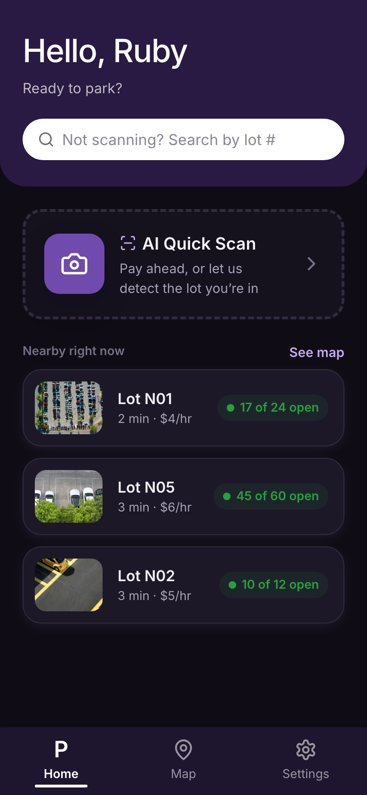
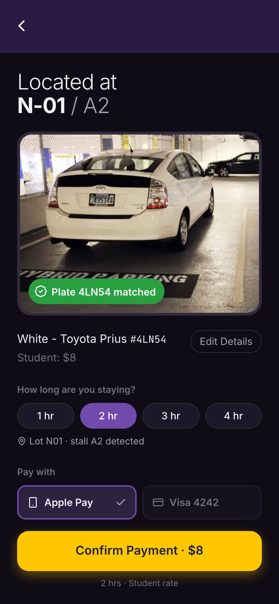
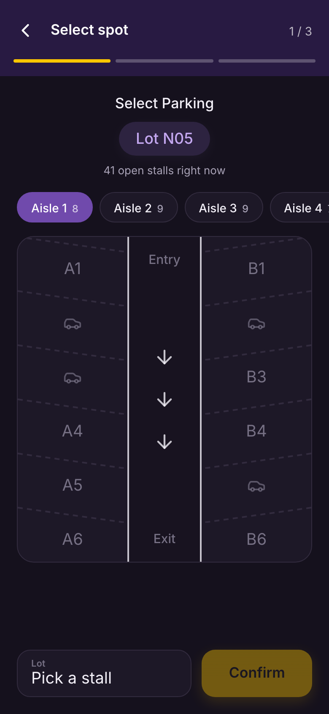
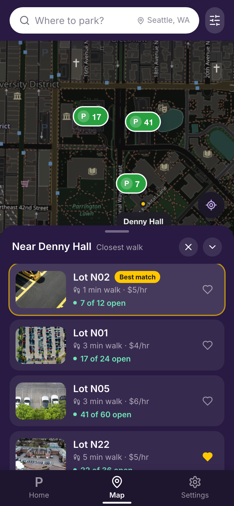
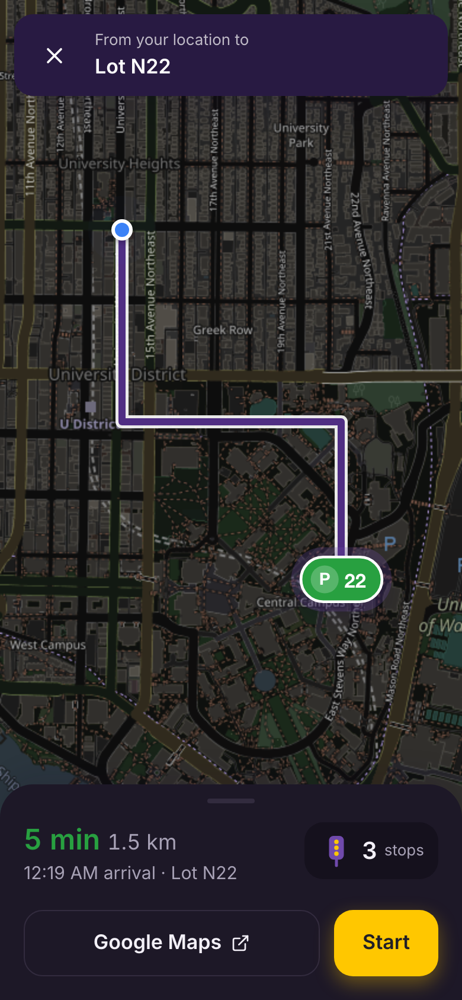
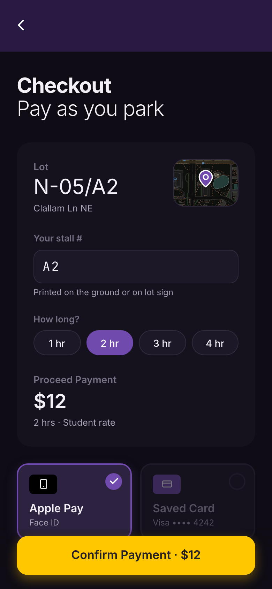

# AcuPark 🚗

AcuPark is a modern, mobile-first parking management application built with Next.js 14. It simplifies the parking experience by allowing users to scan their vehicle, find parking spots, and make reservations seamlessly.

## 🌟 Features

-   **End-to-end flow**: Map → lot details → reserve → confirmed → navigate → arrive & scan → pay → live parking timer.
-   **AI Quick Scan**: Snap your plate to check in on arrival (simulated recognition). Works with a reservation or as a drive-up; falls back to a sample photo when no camera is available.
-   **Interactive Map**: Leaflet with OpenStreetMap tiles.
    -   **Live availability pins**: open-stall counts colored Available / Busy / Full.
    -   **Filters & search**: Near Me, Low Cost, Free Parking, Late Hours, Walkability, EV Charging; search by lot code.
    -   **Recents & Saved**: slide-up drawer of lot photos; heart a lot to save it.
-   **Reservations**:
    -   Pick a stall on an aisle layout (Entry → Exit), then dates, start time and duration.
    -   Role-based pricing (Student / Faculty / Visitor), overlap and past-time validation, cancel anytime before start.
    -   "Starting in" countdown and "Take Me There".
-   **Navigation**: simulated turn-by-turn drive with traffic-light count and a live "spot held · N open" badge (the "anxiety reducer"), plus a Google Maps hand-off.
-   **Payment (UI only)**: Apple Pay or saved card, then a "Paid" confirmation.
-   **Active session**: time remaining, +30 min extension (charged at your rate), 10-minute reminder, end parking, history.
-   **Settings**: campus status, vehicle, default payment, Auto / Light / Dark theme, reset demo data.

All state is kept in the browser (`localStorage`) through a single store in `app/src/lib/store.tsx`; mock lots and helpers live in `app/src/services/mockData.ts`, shaped for a later Supabase swap.

## 🎨 Design System

Colors are CSS variables in `app/src/app/globals.css` (light and `[data-theme="dark"]`), exposed to Tailwind in `app/tailwind.config.ts` as `brand`, `accent`, `ink`, `muted`, `surface`, `card`, `line`, `success`, `warning`, `danger`. Shared building blocks (buttons, cards, sheets, chips, the purple top bar) are in `app/src/components/ui.tsx`. Visuals follow the Figma "Central" page.

## 🎨 Figma Integration (MCP)

This project uses the **Model Context Protocol (MCP)** to connect directly to Figma. This allows the AI to read design properties (layout, colors, typography) and generate code that matches the design files 1:1.

-   **[How to use Figma MCP](./docs/technical/FIGMA_MCP_USAGE.md)**: Detailed guide on setup and usage.
-   **[Understanding MCP](./docs/technical/MCP_EXPLAINED.md)**: Conceptual overview of how MCP works.

## ✨ Vibe Coding with GitHub Copilot

This project was built using the **"Vibe Coding"** methodology—a flow-state driven development process where the developer focuses on intent and design, while GitHub Copilot handles implementation.

-   **[Read the Vibe Coding Guide](./docs/technical/VIBE_CODING.md)**: Learn how we used iterative prompting, the "Master Prompt", and AI-driven refactoring to build AcuPark.

## 📱 Screenshots

| Home Screen | AI Scan | Reservation | Real-time Map | Navigation | Payment |
|:---:|:---:|:---:|:---:|:---:|:---:|
|  |  |  |  |  |  |

## 🛠️ Tech Stack

-   **Framework**: [Next.js 14](https://nextjs.org/) (App Router)
-   **Language**: TypeScript
-   **Styling**: [Tailwind CSS](https://tailwindcss.com/)
-   **Map Engine**: [Leaflet](https://leafletjs.com/) & [React-Leaflet](https://react-leaflet.js.org/)
-   **Icons**: [Lucide React](https://lucide.dev/)
-   **Camera**: [React Webcam](https://www.npmjs.com/package/react-webcam)
-   **Build Tool**: Turbopack (`next dev --turbo`)

## 🚀 Getting Started

### Prerequisites

-   Node.js (v18 or higher)
-   npm or yarn

### Installation

1.  Clone the repository:
    ```bash
    git clone <repository-url>
    cd AcuPark
    ```

2.  Navigate to the app directory:
    ```bash
    cd app
    ```

3.  Install dependencies:
    ```bash
    npm install
    ```

4.  Run the development server:
    ```bash
    npm run dev
    ```

5.  Open [http://localhost:3000](http://localhost:3000) with your browser to see the result.

### 📱 Testing on Mobile

To test the application on your mobile device:

1.  **Connect to the same Wi-Fi**: Ensure your computer and mobile phone are connected to the same network.
2.  **Find your Computer's IP Address**:
    -   **macOS**: Open Terminal and run `ipconfig getifaddr en0`
    -   **Windows**: Open Command Prompt and run `ipconfig` (look for IPv4 Address)
3.  **Run the Server**:
    ```bash
    npm run dev -- -H 0.0.0.0
    ```
4.  **Access on Phone**: Open your mobile browser and navigate to:
    `http://<YOUR_IP_ADDRESS>:3000`
    *(Example: http://192.168.1.5:3000)*

> **Note**: Camera features (AI Scan) may be restricted on mobile browsers when using HTTP. For full camera functionality on mobile, you may need to use a tunneling service like `ngrok` to get an HTTPS URL.

### 📸 Enabling Camera on Mobile (HTTPS)

iOS and Android block camera access on insecure (HTTP) connections. To test the camera, you need a secure HTTPS tunnel.

**Method 1: Using LocalTunnel (No account required)**
1.  Start your app normally: `npm run dev`
2.  In a **new terminal window**, run:
    ```bash
    npx localtunnel --port 3000
    ```
3.  Copy the URL that looks like `https://heavy-zebra-45.loca.lt`
4.  Open that URL on your phone.
    *   *Note: You might see a warning page first. Click "Click to Continue".*

**Method 2: Using Ngrok (More stable)**
1.  Install ngrok: `brew install ngrok/ngrok/ngrok` (Mac)
2.  Run: `ngrok http 3000`
3.  Use the `https://...` URL provided.

## 📱 Usage

1.  **Map**: tap a pin (or search a code like `N22`) → **Reserve**.
2.  Pick a stall, date, time and duration → **Start Reservation**.
3.  **Take Me There** → **Start** (use **Skip ahead** to speed up the demo drive).
4.  On arrival, **Scan & check in** → **Looks Good!** → **Confirm Payment**.
5.  Back on **Home**, watch the timer, tap **+30 min**, or **End parking**.

Or skip the reservation: tap **AI Quick Scan** on Home to check in at the nearest open lot. **Settings → Reset demo data** starts over.

## 📚 Documentation

For more detailed information about the project requirements and technical architecture, please refer to the [docs/](docs/) directory.

## 🤝 Contributing

Contributions are welcome! Please feel free to submit a Pull Request.

## 📄 License

This project is licensed under the MIT License.
