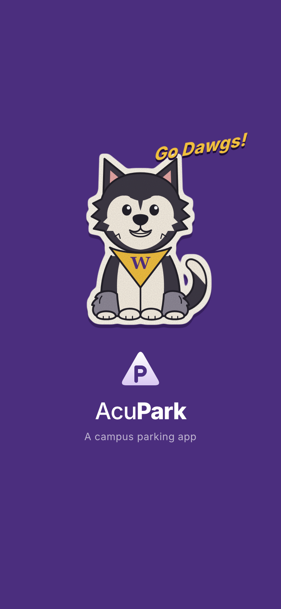

# AcuPark 🚗

AcuPark is a mobile-first campus parking app for the University of Washington, built with Next.js 14. Find a lot, reserve a stall, get there, and pay ahead, on arrival, or on the spot.

**▶ Live demo: [acupark-ten.vercel.app](https://acupark-ten.vercel.app)**. Open it on your phone and use *Add to Home Screen* to get the full-screen app. It's HTTPS, so AI Quick Scan can use the camera. Every merge to `main` redeploys it automatically.

## 🌟 Features

### Launch screen
Every open or refresh starts on a UW-purple splash: **Dubs** the Husky, drawn as a matte retro sticker, springs in, barks once (jaw, ears, head and tail all move) and a slanted **"Go Dawgs!"** pops out, then the AcuPark logo and *A campus parking app* rise in before the app fades up. Open `/preview/splash` to replay it on a loop, with 0.5× and 0.25× slow motion.

### Three ways to pay
| Path | When | How it works |
|---|---|---|
| **Pay ahead** | Before you leave | AI Quick Scan → *Pay ahead*: pick a duration and card, turn on auto-pay. When you arrive, AcuPark detects the lot and stall, pays, and sends **"All set, parking paid!"** with *Review here*. |
| **I'm here — scan now** | In a rush, already parked | AI Quick Scan → *I'm here*: snap your plate; lot, stall and vehicle are detected. Choose how long and **Confirm Payment** on the same screen. |
| **Search to pay now** | Not scanning | Home search *"Not scanning? Search by lot #"* → checkout: confirm your stall, pick a duration, pay. |

Payment is UI-only (Apple Pay or a saved card); nothing is charged.

### Find and reserve
-   **Live map** (Leaflet + OpenStreetMap) with open-stall counts on every pin, colored Available / Busy / Full.
-   **Real UW lots**: N01, N02, N05, N22, E1, E12, E19 and Padelford Garage sit at their OpenStreetMap positions (capacities, rates and hours are mock data).
-   **Campus building search**: type a building or area (Denny Hall, Burke Museum, Art Building, East Campus…) and the drawer lists nearby lots by walking time, with the closest open lot tagged **Best match**.
-   **Draggable lots drawer**: Recents and Saved tabs; drag anywhere on it to open or close. Lot cards drag down to dismiss.
-   **Filters**: Near Me, Low Cost, Free Parking, Late Hours, Walkability, EV Charging.
-   **Reservations**: pick a stall on a slanted-bay aisle layout (Entry → Exit), then dates, start time and duration; "Starting in" countdown and *Take Me There*.
-   **Navigation**: simulated turn-by-turn drive with a traffic-light count and a live "spot held · N open" badge, plus a Google Maps hand-off. Arriving with auto-pay on pays automatically.

### While parked
-   Live timer with **+30 min** (charged at your rate), a 10-minute reminder, End parking, and history.

### Settings
-   **Campus status** (Student / Faculty / Visitor) is verified and read-only; changes go through *Request to change status*, and pricing doesn't change until approved.
-   **Saved vehicles**: add, edit, delete, and choose the one in use (it's what scans match and bookings use).
-   **Default payment**, **Auto / Light / Dark** theme, and **Reset data**.

All state lives in the browser (`localStorage`) through one store in `app/src/lib/store.tsx`; lots, places and helpers are in `app/src/services/mockData.ts`, shaped for a later Supabase swap. See **[docs/project/USER_FLOWS.md](docs/project/USER_FLOWS.md)** for every flow step by step.

## 🎨 Design System

Colors are CSS variables in `app/src/app/globals.css` (light and `[data-theme="dark"]`), exposed to Tailwind in `app/tailwind.config.ts` as `brand`, `accent`, `ink`, `muted`, `surface`, `card`, `line`, `success`, `warning`, `danger`. Shared building blocks (buttons, cards, sheets, chips, the purple top bar) are in `app/src/components/ui.tsx`. Visuals follow the Figma "Central" page.

**Brand**
-   **Logo** (`app/src/components/Logo.tsx`): a rounded triangle carrying a centered parking "P", with the **Acu**Park wordmark. `LogoLockup` comes stacked (splash) or inline (headers), in `onDark` and `onLight` tones.
-   **Dubs** (`app/src/components/DubsBark.tsx`): an original vector Dubs in layered parts (body, tail, head, ears, eyes, jaw) so CSS can animate each one. A single SVG filter turns him into a die-cut sticker: cream border, flat offset shadow and a fine matte grain. Colors are the app's ink and brand purple with a mustard bandana.
-   **Splash** (`app/src/components/Splash.tsx`): flat UW purple `#4B2E7E`; timings live in `globals.css` under `.splash-*`, `.db-*`, `.bark-lines` and `.go-dawgs`, and respect *reduce motion*.

## 🎨 Figma Integration (MCP)

This project uses the **Model Context Protocol (MCP)** to connect directly to Figma. This allows the AI to read design properties (layout, colors, typography) and generate code that matches the design files 1:1.

-   **[How to use Figma MCP](./docs/technical/FIGMA_MCP_USAGE.md)**: Detailed guide on setup and usage.
-   **[Understanding MCP](./docs/technical/MCP_EXPLAINED.md)**: Conceptual overview of how MCP works.

## ✨ Vibe Coding with GitHub Copilot

This project was built using the **"Vibe Coding"** methodology—a flow-state driven development process where the developer focuses on intent and design, while GitHub Copilot handles implementation.

-   **[Read the Vibe Coding Guide](./docs/technical/VIBE_CODING.md)**: Learn how we used iterative prompting, the "Master Prompt", and AI-driven refactoring to build AcuPark.

## 📱 Screenshots

| Launch screen | Home | I'm here (scan) |
|:---:|:---:|:---:|
|  |  |  |
| **Reserve a stall** | **Near a building** | **Navigation** |
|  |  |  |
| **Pay-now checkout** | | |
|  | | |

## 🛠️ Tech Stack

-   **Framework**: [Next.js 14](https://nextjs.org/) (App Router)
-   **Language**: TypeScript
-   **Styling**: [Tailwind CSS](https://tailwindcss.com/)
-   **Map Engine**: [Leaflet](https://leafletjs.com/) & [React-Leaflet](https://react-leaflet.js.org/) with [OpenStreetMap](https://www.openstreetmap.org/) tiles
-   **Icons**: [Lucide React](https://lucide.dev/)
-   **Camera**: [React Webcam](https://www.npmjs.com/package/react-webcam)
-   **Build Tool**: Turbopack (`next dev --turbo`)

## 🚀 Getting Started

### Prerequisites

-   Node.js (v18 or higher)
-   npm or yarn

### Installation

1.  Clone the repository:
    ```bash
    git clone <repository-url>
    cd AcuPark
    ```

2.  Navigate to the app directory:
    ```bash
    cd app
    ```

3.  Install dependencies:
    ```bash
    npm install
    ```

4.  Run the development server:
    ```bash
    npm run dev
    ```

5.  Open [http://localhost:3000](http://localhost:3000) with your browser to see the result.

### 📱 Testing on Mobile

To test the application on your mobile device:

1.  **Connect to the same Wi-Fi**: Ensure your computer and mobile phone are connected to the same network.
2.  **Find your Computer's IP Address**:
    -   **macOS**: Open Terminal and run `ipconfig getifaddr en0`
    -   **Windows**: Open Command Prompt and run `ipconfig` (look for IPv4 Address)
3.  **Run the Server**:
    ```bash
    npm run dev -- -H 0.0.0.0
    ```
4.  **Access on Phone**: Open your mobile browser and navigate to:
    `http://<YOUR_IP_ADDRESS>:3000`
    *(Example: http://192.168.1.5:3000)*

> **Note**: Camera features (AI Scan) may be restricted on mobile browsers when using HTTP. For full camera functionality on mobile, you may need to use a tunneling service like `ngrok` to get an HTTPS URL.

### 📸 Enabling Camera on Mobile (HTTPS)

iOS and Android block camera access on insecure (HTTP) connections. To test the camera, you need a secure HTTPS tunnel.

**Method 1: Using LocalTunnel (No account required)**
1.  Start your app normally: `npm run dev`
2.  In a **new terminal window**, run:
    ```bash
    npx localtunnel --port 3000
    ```
3.  Copy the URL that looks like `https://heavy-zebra-45.loca.lt`
4.  Open that URL on your phone.
    *   *Note: You might see a warning page first. Click "Click to Continue".*

**Method 2: Using Ngrok (More stable)**
1.  Install ngrok: `brew install ngrok/ngrok/ngrok` (Mac)
2.  Run: `ngrok http 3000`
3.  Use the `https://...` URL provided.

## 📱 Usage

**Reserve and drive in**
1.  **Map**: tap a pin, or search a lot code (`N22`) or a building (`Denny Hall`) → **Reserve**.
2.  Pick a stall, date, time and duration → **Start Reservation**.
3.  **Take Me There** → **Start** (use **Skip ahead** to speed up the demo drive).
4.  On arrival, **Scan & check in** → choose payment → **Confirm Payment**.

**Pay ahead**: Home → **AI Quick Scan** → **Pay ahead** → pick a duration → **Turn on auto-pay**. Then tap **Test arrival** on the auto-pay card (or finish a navigation) to see the automatic payment and notification.

**I'm here**: Home → **AI Quick Scan** → **I'm here — scan now** → snap your plate (or *Use sample photo*) → pick how long → **Confirm Payment**.

**Pay now by lot #**: type a lot code in the Home search → confirm your stall and duration → **Confirm Payment**.

Back on **Home**, watch the timer, tap **+30 min**, or **End parking**. **Settings → Reset data** starts over.

## 📚 Documentation

-   **[User flows](docs/project/USER_FLOWS.md)**: every screen and path, step by step.
-   **[Project brief](docs/project/PROJECT_BRIEF.md)**: original requirements and current status.
-   **[Credits](docs/CREDITS.md)**: photo, map data and mascot notes.
-   **[docs/](docs/)**: everything else, including Figma MCP and the Vibe Coding write-up.

## 🤝 Contributing

Contributions are welcome! Please feel free to submit a Pull Request.

## 📄 License

This project is licensed under the MIT License.
